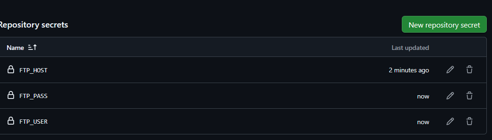
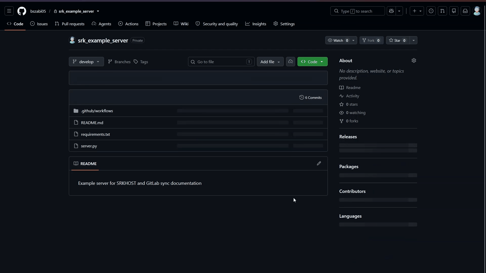

# Automatic File Deployment to SRKHOST Server Using GitHub Actions (SFTP)

When managing a server (whether it's a website, game server, or custom bot), manually uploading files via SFTP clients (such as FileZilla or WinSCP) is tedious, time-consuming, and prone to human error (e.g., placing files into the wrong directory, missing updates, or accidentally overwriting configuration files).

The **goal** of this guide is to demonstrate how to automatically synchronize your code hosted on GitHub with your SRKHOST server over a secure SFTP connection every time you deploy changes (via git push or pull request merge).

:::info **What is GitHub Actions?** GitHub Actions is GitHub's built-in CI/CD platform. Whenever code changes are pushed to your repository, cloud-hosted virtual machines (runners) automatically build, test, and deploy your files to your server.:::

---

## Prerequisites and Gathering Credentials

Before setting up the workflow, make sure you have:

1. **GitHub Account and Repository:** An active GitHub repository where your project code resides.
2. **Active SRKHOST Service:** A running server (e.g., web server, bot, or game server).
3. **SFTP Connection Details:** Found directly in your SRKHOST control panel:
   - **Server Address (Host):** e.g., `node01.srkhost.eu` or the server IP address.
   - **Port:** By default, **`2022`** is used for SFTP connections.
   - **Username:** Your SFTP account identifier (e.g., `username.a1b2c3d4`).
   - **Password:** The password associated with your account / SFTP access.

:::warning **Where to find SFTP credentials?** In your SRKHOST control panel (Pterodactyl panel), select your server, navigate to Settings, and locate the SFTP Details section.:::

---

## Step 1: GitHub Repository and Branch Strategy

Safe deployment requires a disciplined branching workflow. Directly committing to production is strongly discouraged.

- **`develop` branch:** Used for active development and feature testing. Changes here are not pushed to the live server.
- **`main` branch:** Represents the stable, production-ready codebase. The workflow is configured to trigger deployments **only** when changes reach the `main` branch (e.g., upon accepting a Pull Request).

### Protecting the `main` branch (Branch protection rules):
1. In your GitHub repository, navigate to **Settings > Branches**.
2. Click **Add classic branch protection rule**.
3. Under **Branch name pattern**, enter: `main`.
4. Check **Require a pull request before merging**. This prevents untested direct commits to production.

---

## Step 2: Configuring GitHub Secrets

Your SFTP connection credentials (especially your password) must **never** be committed to repository files or your workflow configuration! Instead, store them in GitHub's encrypted secret store (Repository Secrets).

1. In your GitHub repository, click the top **Settings** tab.
2. In the left navigation menu, go to **Secrets and variables > Actions**.
3. Under the **Repository secrets** section, click the green **New repository secret** button.
4. Add the following three secrets:

| Secret Name | Value | Description / Note |
| :--- | :--- | :--- |
| `FTP_HOST` | Server host / IP address (e.g., `node01.srkhost.eu`) | Your SRKHOST server address |
| `FTP_USER` | Your SFTP username | Your SFTP username from the panel |
| `FTP_PASS` | Your SFTP password | The secret SFTP password |



:::info **Automatic Masking in GitHub Actions:** GitHub Actions automatically redacts and replaces all configured repository secrets with asterisks (***) in the job logs, preventing accidental leakage.:::

### Key Considerations When Adding Secrets

- **Case Sensitivity:** Secret names must exactly match those referenced in the workflow YAML file (`FTP_HOST`, `FTP_USER`, `FTP_PASS`).
- **No Extraneous Whitespace:** Make sure no extra spaces or newlines are inadvertently included at the beginning or end of your password or username.
- **Special Characters:** GitHub Actions securely handles special characters (including `$` and `@`). They are cleanly passed into the runner via step environment variables (`env:`).

---

## Step 3: Creating the Workflow File (`.github/workflows/deploy.yml`)

GitHub Actions workflows are defined in YAML files located in the `.github/workflows/` directory.

1. In your repository root, create the directory structure and file: `.github/workflows/deploy.yml`.
2. Insert the following code:

```yaml
name: Deploy to SRKHOST

on:
  push:
    # Trigger deployment only on changes pushed or merged to the 'main' branch
    branches:
      - main

jobs:
  deploy:
    # Run workflow on a clean, fresh Ubuntu Linux virtual environment
    runs-on: ubuntu-latest
    steps:
      # Step 1: Check out repository files into the runner workspace
      - name: Get files
        uses: actions/checkout@v4

      # Step 2: Update package lists and install lftp and OpenSSH client
      - name: Install dependencies
        run: sudo apt-get update && sudo apt-get install -y lftp openssh-client

      # Step 3: Synchronize files to the SRKHOST server via SFTP
      - name: Upload files to SFTP
        env:
          # Inject encrypted GitHub Repository Secrets as environment variables
          FTP_HOST: ${{ secrets.FTP_HOST }}
          FTP_USER: ${{ secrets.FTP_USER }}
          FTP_PASS: ${{ secrets.FTP_PASS }}
        run: |
          # sftp:auto-confirm yes accepts host key. Connect via port 2022 and mirror files.
          lftp -c "set sftp:auto-confirm yes; open -u $FTP_USER,$FTP_PASS sftp://$FTP_HOST:2022; mirror -Rnev ./ / --ignore-time --parallel=10 --exclude-glob .git* --exclude .github/"
```

---

## Breakdown of the Workflow and `lftp mirror` Command

### How the Workflow Operates:
- `name: Deploy to SRKHOST`: Display name shown in the GitHub Actions dashboard.
- `on: push: branches: [ main ]`: The deployment triggers whenever new commits are pushed or merged into `main`.
- `runs-on: ubuntu-latest`: Spawns a clean Ubuntu Linux virtual machine runner.
- `actions/checkout@v4`: Clones repository contents into the runner workspace.
- `sudo apt-get ...`: Installs `lftp` and `openssh-client` via Ubuntu's package manager.
- `env:`: Securely exposes GitHub repository secrets as local shell environment variables.

### Detailed Breakdown of the `lftp mirror` Flags:

| Flag / Option | Description & Purpose |
| :--- | :--- |
| `set sftp:auto-confirm yes` | Automatically trusts and accepts the remote host's SSH fingerprint, preventing interactive prompts that hang the runner. |
| `open -u $FTP_USER,$FTP_PASS ...` | Establishes an SFTP connection on port `2022` using the credentials supplied by GitHub Secrets. |
| `mirror` | Synchronization command comparing source and destination directory contents. |
| `-R` (`--reverse`) | Reverse mirror: uploads local files (from the GitHub runner) to the remote server. |
| `-n` (`--only-newer`) | Only transfers newer or size-modified files, minimizing network bandwidth and deployment time. |
| `-e` (`--delete`) | **Deletes remote files that no longer exist in the local repository.** (See critical warning below!) |
| `-v` (`--verbose`) | Outputs detailed logging into the Actions console, showing exactly which files are uploaded or removed. |
| `--ignore-time` | Git does not retain file timestamps. This flag instructs `lftp` to compare file sizes rather than timestamps. |
| `--parallel=10` | Uploads up to 10 files simultaneously, greatly speeding up deployments for multi-file projects. |
| `--exclude-glob .git*` | Excludes Git tracking directories and files (`.git/`, `.gitignore`, etc.). |
| `--exclude .github/` | Prevents GitHub workflow files and metadata from being uploaded to the server root. |

:::danger **CAUTION: Dangers of the -e (--delete) flag!** If your server produces runtime files (such as database.sqlite, logs/, uploads, or game saves) not tracked in Git, lftp will delete them! Remove the -e flag for additive sync or add --exclude rules!:::

---

## Step 4: Running and Verifying the Workflow

1. Commit and push your changes to your working branch.
2. Open a Pull Request from `develop` into `main`, and merge it.
3. In the top navigation tabs, click **Actions**.
4. Select the latest run under the **Deploy to SRKHOST** workflow.
5. Click the `deploy` job to inspect live terminal output and verify uploaded files.



:::success **Successful Run:** When the workflow finishes with a green checkmark, your files have been successfully transferred to your SRKHOST server!:::

---

## Things to Keep in Mind (Practical Considerations)

### 1. Server Restarts and Process Reloading
SFTP only synchronizes files on the filesystem:
- For running **Node.js bots**, **Python apps**, or **Minecraft servers**, updating files does not automatically restart the process.
- Restart your server manually via the web panel, or configure file-watching tools (e.g., `nodemon`, `pm2 watch`) if your runtime environment supports it.

### 2. Handling Environment Files (`.env`)
Production secrets and API credentials should reside in `.env` files:
- **Never commit `.env` into your Git repository** (add it to `.gitignore`).
- Create and maintain the production `.env` file directly through the SRKHOST web file manager.
- Add `--exclude .env` to your `lftp mirror` command so the sync job will never delete or overwrite your live config:
  ```bash
  --exclude .env
  ```

### 3. Dependencies and Build Steps (`node_modules`, `vendor`)
Never commit dependency folders (`node_modules`, `vendor`, `.venv`) to Git:
- **Static sites / Frontend frameworks (React, Vue, Vite):** Add a build step to the workflow (`npm ci && npm run build`) before deployment, and upload only the generated `dist/` or `build/` directory.

### 4. Deploying to a Subdirectory
If you want to deploy code into a specific subfolder rather than the server root (e.g., into `/plugins/MyPlugin/` or `/public_html/`):
- Change the destination path in the `lftp mirror` command:
  ```bash
  # Example: uploading local files to /plugins/MyPlugin/ on the remote server
  mirror -Rnev ./ /plugins/MyPlugin/ ...
  ```

---

## Pro Tips

### Tip 1: Manual Trigger via Button (`workflow_dispatch`)
To allow triggering deployments on demand from the GitHub UI using a **Run workflow** button, add `workflow_dispatch:` to the `on:` trigger:

```yaml
on:
  push:
    # Automatic trigger on push to the main branch
    branches:
      - main
  # Enables manual execution via the 'Run workflow' button in GitHub Actions
  workflow_dispatch:
```

### Tip 2: Prevent Concurrent Deployments (`concurrency`)
If multiple commits or merges happen in quick succession, simultaneous uploads might conflict. Use `concurrency` to serialize runs:

```yaml
jobs:
  deploy:
    runs-on: ubuntu-latest
    # Prevents simultaneous overlapping deployments if multiple commits are pushed rapidly
    concurrency:
      group: srkhost-deploy
      cancel-in-progress: false
    steps:
      - name: Get files
        uses: actions/checkout@v4
      # ... subsequent steps remain unchanged
```

### Tip 3: Dry Run Testing (`--dry-run`)
Before running a synchronization with file deletion enabled, add the `--dry-run` flag to test what `lftp` would do without making actual changes:

```bash
mirror -Rnev --dry-run ./ / ...
```

---

## Troubleshooting & Common Errors

| Log Error | Root Cause | Solution |
| :--- | :--- | :--- |
| `Fatal error: Host key verification failed` | The SSH client rejects the untrusted host key. | Ensure `set sftp:auto-confirm yes;` is present at the beginning of the `lftp -c` command. |
| `Login incorrect` or `Authentication failed` | Incorrect username/password, or missing Secret. | 1. Verify `FTP_USER` and `FTP_PASS` names and values in GitHub Repository Secrets.<br>2. Ensure no unintended leading or trailing spaces exist in secret values. |
| `Connection timed out` or `Connection refused` | Server unreachable or firewall blocking port. | 1. Verify `FTP_HOST` and ensure port **2022** is used.<br>2. Check if the server is in "Running" status in the SRKHOST panel. |
| `Access denied` | Insufficient permissions on destination folder. | Verify SFTP user permissions and folder permissions in the server file manager. |
| Remote files disappeared after deployment | The `-e` (`--delete`) flag removed untracked files. | Remove `-e` from the `mirror` command or protect folders using `--exclude`. |
