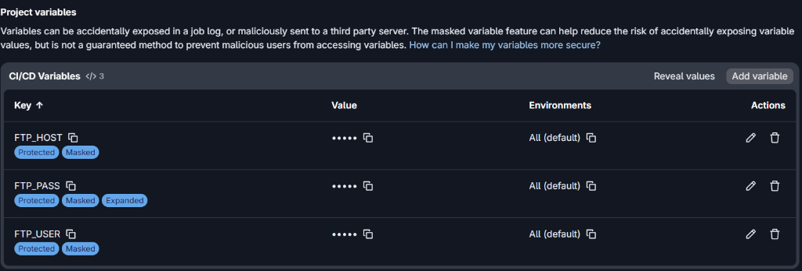
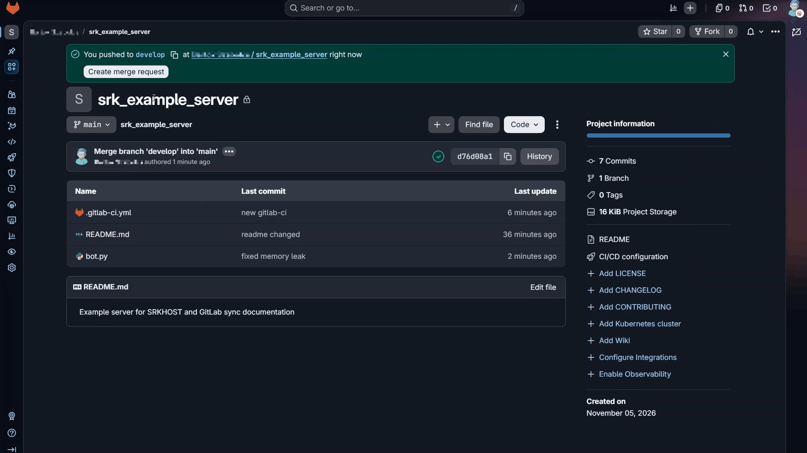

# Automatic File Deployment to SRKHOST Server Using GitLab CI/CD (SFTP)

When managing a server (whether it's a website, game server, or custom bot), manually uploading files via SFTP clients (such as FileZilla or WinSCP) is tedious, time-consuming, and prone to human error (e.g., placing files into the wrong directory, missing updates, or accidentally overwriting configuration files).

The **goal** of this guide is to demonstrate how to automatically synchronize your code hosted on GitLab with your SRKHOST server over a secure SFTP connection every time you deploy changes (via git push or merge).

:::info **What is CI/CD?** CI/CD is an automated workflow practice: developers simply push code changes to the Git repository, while the background GitLab Runner handles testing, building, and deploying the files to the server automatically.:::

---

## Prerequisites and Gathering Credentials

Before setting up the pipeline, make sure you have:

1. **GitLab Account and Project:** An active GitLab repository where your project code resides.
2. **Active SRKHOST Service:** A running server (e.g., web server, bot, or game server).
3. **SFTP Connection Details:** Found directly in your SRKHOST control panel:
   - **Server Address (Host):** e.g., `node01.srkhost.eu` or the server IP address.
   - **Port:** By default, **`2022`** is used for SFTP connections.
   - **Username:** Your SFTP account identifier (e.g., `username.a1b2c3d4`).
   - **Password:** The password associated with your account / SFTP access.

:::warning **Where to find SFTP credentials?** In your SRKHOST control panel (Pterodactyl panel), select your server, navigate to Settings, and locate the SFTP Details section.:::

---

## Step 1: GitLab Repository and Branch Strategy

Safe deployment requires a disciplined branching workflow. Directly committing to production is strongly discouraged.

- **`develop` branch:** Used for active development and feature testing. Changes here are not pushed to the live server.
- **`main` branch:** Represents the stable, production-ready codebase. The CI/CD pipeline is configured to trigger deployments **only** when changes reach the `main` branch (e.g., upon accepting a Merge Request).

### Protecting the `main` branch:
1. In your project navigation menu, go to **Settings > Repository**.
2. Expand the **Protected branches** section.
3. Ensure `main` is protected and direct pushes are restricted (e.g., allowed only to Maintainers or restricted to Merge Requests only).

---

## Step 2: Configuring CI/CD Variables (Secrets)

Your SFTP connection credentials (especially your password) must **never** be hardcoded into your repository or the `.gitlab-ci.yml` file. Anyone with repository access would immediately gain server control. Instead, use GitLab's encrypted environment variables.

1. In your GitLab project menu, navigate to **Settings > CI/CD**.
2. Expand the **Variables** section and click **Add variable**.
3. Create the following three variables:

| Variable Name (Key) | Value | Environments | Flags / Type |
| :--- | :--- | :--- | :--- |
| `FTP_HOST` | Server host / IP address (e.g., `node01.srkhost.eu`) | `All (default)` | `Protected`, `Masked` |
| `FTP_USER` | Your SFTP username | `All (default)` | `Protected`, `Masked` |
| `FTP_PASS` | Your SFTP password | `All (default)` | `Protected`, `Masked`, `Expanded` |



### Key Considerations When Adding Variables

:::info **Why Protected and Masked settings matter:** The Protected toggle ensures secrets are only injected into protected branches (e.g., main), and Masked hides the values in runner logs ([MASKED]).:::

#### Important details regarding your variables:
- **Protected:** All three variables are marked as `Protected`. This guarantees that secrets are only injected into pipelines running on protected branches (such as `main`). Unprotected feature branches cannot access them, preventing accidental deployments or leaks.
- **Masked:** All three variables are masked, ensuring neither your password nor your host address or username will appear in the plaintext build logs—they are replaced with `[MASKED]`.
- **Expanded flag on `FTP_PASS`:** If your password contains a `$` character (e.g., `P@ss$word`), GitLab may attempt to expand it as an environment variable due to the `Expanded` mode, which can truncate the password and cause `Login incorrect` errors. If your password contains a `$`, uncheck **Expand variable** when saving.
- **Masking requirements:** GitLab requires masked values to be at least 8 characters long, single-line, and without forbidden character sequences.

:::warning **Watch out for dollar signs ($):** If your SFTP password contains a dollar sign, uncheck the Expand variable option to avoid GitLab attempting variable expansion!:::

---

## Step 3: Creating the Pipeline Configuration (`.gitlab-ci.yml`)

The deployment process is orchestrated by a `.gitlab-ci.yml` file located in the root directory of your repository.

1. In the repository root, create a file named `.gitlab-ci.yml`.
2. Insert the following configuration:

```yaml
stages:
  - deploy

deploy_to_srkhost:
  stage: deploy
  image: alpine:latest
  before_script:
    # Update package lists and install lftp and openssh-client
    - apk update && apk add --no-cache lftp openssh-client
  script:
    # Connect and synchronize files using LFTP
    - lftp -c "set sftp:auto-confirm yes; open -u $FTP_USER,$FTP_PASS sftp://$FTP_HOST:2022; mirror -Rnev ./ / --ignore-time --parallel=10 --exclude-glob .git* --exclude .gitlab-ci.yml"
  only:
    # Trigger deployment only on changes to the 'main' branch
    - main
```

---

## Detailed Breakdown of the `lftp mirror` Command

The synchronization is performed using `lftp`, an advanced and resilient file transfer utility:

| Flag / Option | Description & Purpose |
| :--- | :--- |
| `set sftp:auto-confirm yes` | Automatically trusts and accepts the remote host's SSH fingerprint, preventing interactive prompts that cause pipeline timeouts. |
| `open -u $FTP_USER,$FTP_PASS ...` | Establishes an SFTP connection on port `2022` using the credentials supplied by GitLab variables. |
| `mirror` | Synchronization command comparing source and destination directory contents. |
| `-R` (`--reverse`) | Reverse mirror: uploads local files (from the GitLab runner) to the remote server. |
| `-n` (`--only-newer`) | Only transfers newer or size-modified files, minimizing network bandwidth and deployment time. |
| `-e` (`--delete`) | **Deletes remote files that no longer exist in the local repository.** (See critical warning below!) |
| `-v` (`--verbose`) | Outputs detailed logging into the CI/CD console, showing exactly which files are uploaded or removed. |
| `--ignore-time` | Git does not retain file creation/modification timestamps. This flag instructs `lftp` to compare file sizes rather than timestamps. |
| `--parallel=10` | Uploads up to 10 files simultaneously, greatly speeding up deployments for multi-file projects. |
| `--exclude-glob .git*` | Excludes Git tracking directories and files (`.git/`, `.gitignore`, etc.). |
| `--exclude .gitlab-ci.yml` | Prevents the CI configuration file from being uploaded to the server root. |

:::danger **CAUTION: Dangers of the -e (--delete) flag!** If your server produces runtime files (such as database.sqlite, logs/, uploads, or game saves) not tracked in Git, lftp will delete them! Remove the -e flag for additive sync or add --exclude rules!:::

---

## Step 4: Running and Verifying the Pipeline

1. Commit and push your changes to your working branch.
2. Open a Merge Request from `develop` into `main`, and merge it.
3. In the left navigation sidebar, navigate to **Build > Pipelines** (or **CI/CD > Pipelines** in older versions).
4. Click on the running `deploy_to_srkhost` job to inspect live terminal output.



:::success **Successful Run:** When the pipeline finishes with a green checkmark (Job succeeded), your files have been successfully transferred to your SRKHOST server!:::

---

## Things to Keep in Mind (Practical Considerations)

### 1. Server Restarts and Process Reloading
SFTP only synchronizes files on the filesystem:
- For running **Node.js bots**, **Python apps**, or **Minecraft servers**, updating files does not automatically restart the process.
- Restart your server manually via the web panel, or configure file-watching tools (e.g., `nodemon`, `pm2 watch`) if your runtime environment supports it.

### 2. Handling Environment Files (`.env`)
Production secrets and API credentials should reside in `.env` files:
- **Never commit `.env` into your Git repository** (add it to `.gitignore`).
- Create and maintain the production `.env` file directly through the SRKHOST web file manager.
- Add `--exclude .env` to your `lftp mirror` command so the sync job will never delete or overwrite your live config:
  ```bash
  --exclude .env
  ```

### 3. Dependencies and Build Steps (`node_modules`, `vendor`)
Never commit dependency folders (`node_modules`, `vendor`, `.venv`) to Git:
- **Static sites / Frontend frameworks (React, Vue, Vite):** Add a build stage to the pipeline (`npm ci && npm run build`) and configure `lftp` to upload only the generated `dist/` or `build/` directory.
- **Node.js applications:** Ensure your server environment can run install steps upon restart or consider pre-packaging artifacts if needed.

### 4. Deploying to a Subdirectory
If you want to deploy code into a specific subfolder rather than the server root (e.g., into `/plugins/MyPlugin/` or `/public_html/`):
- Change the destination path in the `lftp mirror` command:
  ```bash
  # Example: uploading local files to /plugins/MyPlugin/ on the remote server
  mirror -Rnev ./ /plugins/MyPlugin/ ...
  ```

---

## Pro Tips

### Tip 1: Manual Approval for Deployments (`when: manual`)
If you prefer triggering deployments on demand rather than automatically upon every merge, add `when: manual` to your job definition:

```yaml
deploy_to_srkhost:
  stage: deploy
  image: alpine:latest
  before_script:
    - apk update && apk add --no-cache lftp openssh-client
  script:
    - lftp -c "set sftp:auto-confirm yes; open -u $FTP_USER,$FTP_PASS sftp://$FTP_HOST:2022; mirror -Rnev ./ / --ignore-time --parallel=10 --exclude-glob .git* --exclude .gitlab-ci.yml"
  only:
    - main
  when: manual
```

### Tip 2: Dry Run Testing (`--dry-run`)
Before running a synchronization with file deletion enabled, add the `--dry-run` flag to test what `lftp` would do without making actual changes:

```bash
mirror -Rnev --dry-run ./ / ...
```

### Tip 3: Faster Pipelines with `--no-cache`
Using `apk add --no-cache` prevents caching the Alpine package index locally inside the runner container, saving startup time and bandwidth.

---

## Troubleshooting & Common Errors

| Log Error | Root Cause | Solution |
| :--- | :--- | :--- |
| `Fatal error: Host key verification failed` | The SSH client rejects the untrusted host key. | Ensure `set sftp:auto-confirm yes;` is present at the beginning of the `lftp -c` command. |
| `Login incorrect` or `Authentication failed` | Incorrect username/password, or empty variables. | 1. Verify `FTP_USER` and `FTP_PASS` in GitLab Variables.<br>2. If the variable is *Protected*, ensure the target branch is also *Protected*.<br>3. If the password has a `$`, disable *Expand variable*. |
| `Connection timed out` or `Connection refused` | Server unreachable or firewall blocking port. | 1. Verify `FTP_HOST` and ensure port **2022** is used.<br>2. Check if the server is in "Running" status in the SRKHOST panel. |
| `Access denied` | Insufficient permissions on destination folder. | Verify SFTP user permissions and folder permissions in the server file manager. |
| Remote files disappeared after deployment | The `-e` (`--delete`) flag removed untracked files. | Remove `-e` from the `mirror` command or protect folders using `--exclude`. |
