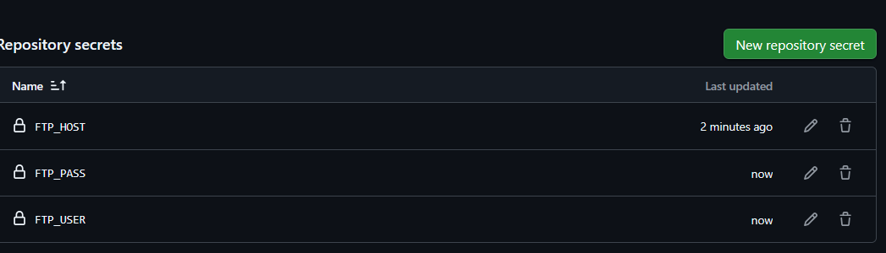
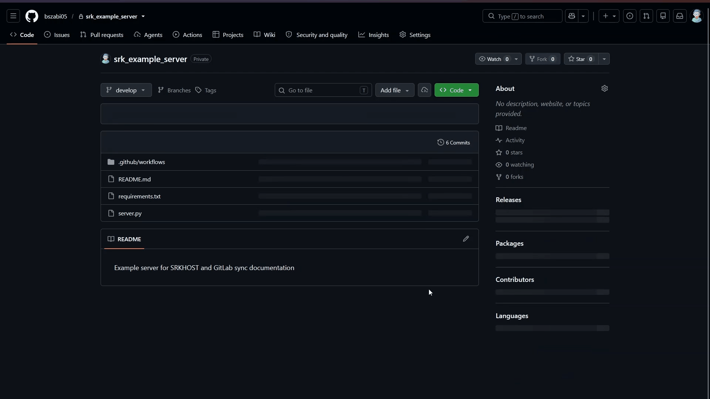

# Fájlok automatikus feltöltése SRKHOST szerverre GitHub Actions (SFTP) segítségével

Amikor egy szervert üzemeltetsz (legyen az weboldal, játékszerver vagy egyedi bot), a fájlok manuális másolása SFTP klienseken (pl. FileZilla, WinSCP) keresztül időigényes, monoton, és folyamatosan magában hordozza az emberi tévedések lehetőségét (pl. rossz mappába másolt fájlok, kimaradt frissítések vagy véletlenül felülírt konfigurációk).

Ennek a leírásnak a **célja**, hogy bemutassa: hogyan tudod a GitHubon tárolt kódodat egy automatizált GitHub Actions workflow segítségével, biztonságos SFTP kapcsolaton keresztül szinkronizálni az SRKHOST szervereddel minden egyes élesítéskor (git push vagy pull request merge esetén).

:::info **Mi az a GitHub Actions?** A GitHub Actions a GitHub beépített CI/CD automatizálási eszköze. Segítségével a tárolóba küldött módosítások hatására a GitHub felhőjében futó virtuális gépek (runnerek) automatikusan elvégzik a buildelést, tesztelést és a fájlok szerverre töltését.:::

---

## Előfeltételek és adatok összegyűjtése

A beállítás előtt gondoskodj a következőkről:

1. **GitHub fiók és repository:** Egy működő GitHub tároló, ahol a projekt kódját kezeled.
2. **Aktív SRKHOST szolgáltatás:** Egy futó szerver (pl. web, bot vagy játékszerver).
3. **SFTP hozzáférési adatok:** Ezeket az SRKHOST szerverkezelő felületén találod:
   - **Szerver címe (Host):** pl. `node01.srkhost.eu` vagy a szerver IP címe.
   - **Port:** Alapértelmezetten a **`2022`**-es portot használjuk SFTP kapcsolathoz.
   - **Felhasználónév (Username):** Az SFTP fiókod azonosítója (pl. `felhasznalonev.a1b2c3d4`).
   - **Jelszó (Password):** A fiókodhoz tartozó jelszó.

:::warning **Hol találod az SFTP adatokat?** Az SRKHOST vezérlőpultján (Pterodactyl panel) válaszd ki a szerveredet, lépj a Beállítások (Settings) menüpontra, és keresd meg az SFTP Details szekciót.:::

---

## 1. Lépés: A GitHub Repository és az ágstratégia (Branches)

A profi és biztonságos fejlesztés alapköve a megfelelő ágkezelés. Soha nem javasolt közvetlenül az éles ágon kísérletezni!

- **`develop` ág:** Ide kerülnek a folyamatban lévő fejlesztések és új funkciók. Ez nem töltődik fel azonnal a szerverre.
- **`main` ág:** Ez a stabil, tesztelt állapotot tükröző ág. A workflow-t úgy konfiguráljuk, hogy **kizárólag** a `main` ágra történő módosításkor (pl. Pull Request elfogadásakor) induljon el a feltöltés.

### A `main` ág levédése (Branch protection rules):
1. Navigálj a projektedben a felső menüsorban ide: **Settings > Branches**.
2. Kattints az **Add classic branch protection rule** gombra.
3. A **Branch name pattern** mezőbe írd be: `main`.
4. Pipáld be a **Require a pull request before merging** lehetőséget. Ez megakadályozza, hogy véletlenül közvetlenül a `main` ágra pusholj kódot tesztelés nélkül.

---

## 2. Lépés: GitHub Secrets (Titkos adatok) beállítása

Az SFTP csatlakozáshoz szükséges adatokat (különösen a jelszavadat) **szigorúan tilos** közvetlenül a kódba vagy a workflow fájlba beírni! Ehelyett a GitHub titkosított tárolóját (Repository Secrets) használjuk.

1. A GitHub repository oldalán kattints a felső **Settings** fülre.
2. A bal oldali menüben válaszd a **Secrets and variables > Actions** lehetőséget.
3. A **Repository secrets** szekciónál kattints a zöld **New repository secret** gombra.
4. Hozd létre az alábbi három titkos adatot:

| Titkos adat neve (Name) | Érték (Value) | Leírás / Megjegyzés |
| :--- | :--- | :--- |
| `FTP_HOST` | A szervered címe / IP címe (pl. `node01.srkhost.eu`) | Az SRKHOST szerver címe |
| `FTP_USER` | Az SFTP felhasználóneved | Az SFTP azonosítód a panelből |
| `FTP_PASS` | Az SFTP jelszavad | Az SFTP fiókodhoz tartozó jelszó |



:::info **Automatikus maszkolás a GitHub Actions-ben:** A GitHub automatikusan csillagokkal (***) helyettesíti az összes felvett Secret értékét a futási naplókban, így azok véletlenül sem jelenhetnek meg nyilvánosan.:::

### Mire figyelj a Secret adatok rögzítésekor?

- **Kis- és nagybetű érzékenység:** A titkos adatok neve pontosan egyezzen meg a workflow kódban szereplő névvel (`FTP_HOST`, `FTP_USER`, `FTP_PASS`).
- **Nincsenek felesleges szóközök:** Ügyelj arra, hogy a jelszó és a felhasználónév beillesztésekor ne maradjon véletlen szóköz vagy sortörés a mező elején vagy végén.
- **Speciális karakterek:** A GitHub Actions biztonságosan kezeli a speciális karaktereket (beleértve a `$` és `@` jeleket is), a workflow-ban környezeti változókon (`env:`) keresztül adjuk át őket az `lftp` parancsnak.

---

## 3. Lépés: A Workflow fájl létrehozása (`.github/workflows/deploy.yml`)

A GitHub Actions a projekt `.github/workflows/` mappájában elhelyezett YAML konfigurációs fájlokból dolgozik.

1. Hozd létre a repódban az alábbi mappastruktúrát és fájlt: `.github/workflows/deploy.yml`.
2. Másold be az alábbi kódot:

```yaml
name: Deploy to SRKHOST

on:
  push:
    # A feltöltés kizárólag akkor fut le, ha a 'main' ágra érkezik módosítás
    branches:
      - main

jobs:
  deploy:
    # A feladat egy tiszta, friss Ubuntu Linux virtuális környezetben fut le
    runs-on: ubuntu-latest
    steps:
      # 1. Lépés: A repóban található fájlok letöltése a runner munkakönyvtárába
      - name: Get files
        uses: actions/checkout@v4

      # 2. Lépés: Csomaglista frissítése, majd az lftp és a kapcsolódáshoz szükséges OpenSSH feltelepítése
      - name: Install dependencies
        run: sudo apt-get update && sudo apt-get install -y lftp openssh-client

      # 3. Lépés: Fájlok szinkronizálása az SRKHOST szerverre SFTP protokollon keresztül
      - name: Upload files to SFTP
        env:
          # A korábban beállított GitHub Repository Secrets átadása környezeti változókként
          FTP_HOST: ${{ secrets.FTP_HOST }}
          FTP_USER: ${{ secrets.FTP_USER }}
          FTP_PASS: ${{ secrets.FTP_PASS }}
        run: |
          # Az sftp:auto-confirm yes elfogadja a szerver SSH kulcsát. Csatlakozás a 2022-es porton.
          lftp -c "set sftp:auto-confirm yes; open -u $FTP_USER,$FTP_PASS sftp://$FTP_HOST:2022; mirror -Rnev ./ / --ignore-time --parallel=10 --exclude-glob .git* --exclude .github/"
```

---

## A Workflow és az `lftp mirror` parancs részletes magyarázata

### Hogyan működik a GitHub Actions folyamat?
- `name: Deploy to SRKHOST`: A munkafolyamat megjelenített neve az Actions felületén.
- `on: push: branches: [ main ]`: A folyamat automatikusan elindul, amint új commit érkezik a `main` ágra (akár közvetlen push, akár Pull Request merge útján).
- `runs-on: ubuntu-latest`: A GitHub egy tiszta, friss Ubuntu Linux virtuális gépet indít a feladat elvégzéséhez.
- `actions/checkout@v4`: Letölti a repód fájljait a futtató környezetbe.
- `sudo apt-get ...`: Feltelepíti az SFTP kezeléséhez szükséges `lftp` és `openssh-client` csomagokat.
- `env:`: Biztonságosan átadja a GitHub Secrets értékeit helyi környezeti változókként.

### Az `lftp mirror` paramétereinek boncolása:

| Kapcsoló / Részlet | Jelentése és funkciója |
| :--- | :--- |
| `set sftp:auto-confirm yes` | Automatikusan elfogadja a távoli szerver SSH ujjlenyomatát (host key), megakadályozva a kapcsolat megszakadását. |
| `open -u $FTP_USER,$FTP_PASS ...` | Kapcsolódik az SFTP szerverhez a 2022-es porton a titkos adatok felhasználásával. |
| `mirror` | Tükrözési funkció, amely a forrás- és a célkönyvtár tartalmát összehasonlítva szinkronizál. |
| `-R` (`--reverse`) | Fordított szinkronizálás: a helyi (GitHub Runner) könyvtárat tölti fel a távoli szerverre, nem pedig fordítva. |
| `-n` (`--only-newer`) | Csak az újabb vagy méretben eltérő fájlokat tölti fel, elkerülve a felesleges hálózati forgalmat. |
| `-e` (`--delete`) | **Törli a szerveren lévő fájlokat, ha azok a Git repóban már nem léteznek.** (Lásd a lenti figyelmeztetést!) |
| `-v` (`--verbose`) | Részletes kimenetet generál az Actions logba, így pontosan látni fogod, melyik fájlok lettek feltöltve vagy frissítve. |
| `--ignore-time` | A Git nem őrzi meg az eredeti fájl-időbélyegeket, ezért ez a kapcsoló méret és tartalom alapján vizsgálja a változásokat. |
| `--parallel=10` | Egyszerre akár 10 párhuzamos szálon tölt fel, ami sok kisebb fájl esetén drasztikusan csökkenti a feltöltési időt. |
| `--exclude-glob .git*` | Figyelmen kívül hagyja a Git belső mappáit (`.git`, `.gitignore`, `.gitattributes`). |
| `--exclude .github/` | Megakadályozza, hogy maguk a GitHub workflow fájlok felkerüljenek az SRKHOST szerverre. |

:::danger **FIGYELEM: A -e (--delete) kapcsoló veszélyei!** Ha a szervereden futás közben keletkező adatok vannak (pl. database.sqlite, logs/, mentések), és ezek nincsenek a Git repóban, az lftp törölni fogja őket! Dinamikus adatok esetén távolítsd el a -e kapcsolót, vagy adj hozzá --exclude szabályokat!:::

---

## 4. Lépés: A Workflow futtatása és ellenőrzése

1. Küldd be a módosításokat a repóba (commit & push).
2. Nyiss egy Pull Requestet a `develop` ágról a `main` ágra, majd fogadd el (Merge pull request).
3. A felső menüben kattints az **Actions** fülre.
4. Válaszd ki a legutóbbi futást a **Deploy to SRKHOST** listából.
5. A `deploy` feladatra kattintva élőben követheted a terminálkimenetet és az átmásolt fájlok listáját.



:::success **Sikeres lefutás:** Ha a workflow zöld pipával fejeződik be, a módosítások sikeresen és hiánytalanul megjelentek az SRKHOST szervereden!:::

---

## Mire figyelj még? (Fontos észrevételek a gyakorlatból)

### 1. Szerver újraindítása / Újratöltés
Az SFTP szinkronizáció kizárólag a fájlokat másolja át a háttértárra.
- Ha például egy **Node.js botot**, **Python alkalmazást** vagy **Minecraft szervert** futtatsz, a fájlok cseréjétől az alkalmazás nem indul újra magától.
- Szükség esetén indítsd újra a szervert a webes vezérlőpulton, vagy használj folyamatfigyelőt (pl. `nodemon`, `pm2 watch`).

### 2. Környezeti konfigurációs fájlok (`.env`) kezelése
Éles környezetben gyakran használsz adatbázis-jelszavakat vagy privát API kulcsokat `.env` fájlban:
- Ezt a fájlt **soha ne pushold fel a Git repóba** (legyen benne a `.gitignore`-ban)!
- Hozd létre a `.env` fájlt közvetlenül az SRKHOST webes fájlkezelőjében.
- Egészítsd ki a parancsot az `--exclude .env` kapcsolóval, hogy a szinkronizáció ne törölje le vagy ne írja felül az éles fájlt:
  ```bash
  --exclude .env
  ```

### 3. Függőségek és build folyamatok (`node_modules`, `vendor`)
Soha ne tárolj függőségi könyvtárakat (pl. `node_modules`, `vendor`, `.venv`) a Git repository-ban!
- **Statikus weboldalak / Frontend projektek (React, Vue, Vite):** Egészítsd ki a workflow-t egy build lépéssel a feltöltés előtt (`npm ci && npm run build`), és csak a kész `dist/` vagy `build/` mappát szinkronizáld.

### 4. Feltöltés almappába
Ha nem a szerver gyökérkönyvtárába (`/`), hanem egy adott mappába szeretnéd tölteni a kódodat (például egy Minecraft plugin mappájába vagy egy weboldal `public_html` mappájába):
- Módosítsd a cél útvonalat az `lftp mirror` parancsban:
  ```bash
  # Példa: a helyi gyökérből a szerver /plugins/MyPlugin/ mappájába
  mirror -Rnev ./ /plugins/MyPlugin/ ...
  ```

---

## Tippek és trükkök (Pro Tips)

### 1. Tipp: Kézi indítás engedélyezése gombnyomásra (`workflow_dispatch`)
Ha szeretnéd, hogy a GitHub felületén bármikor megjelenjen egy **Run workflow** gomb, amellyel manuálisan is elindíthatod a feltöltést, egészítsd ki az `on:` szakaszt a `workflow_dispatch:` opcióval:

```yaml
on:
  push:
    # Automatikus indítás a main ágra érkező módosításokkor
    branches:
      - main
  # Lehetővé teszi a manuális indítást a GitHub felületén lévő 'Run workflow' gombbal
  workflow_dispatch:
```

### 2. Tipp: Egymásba futó pipeline-ok megelőzése (`concurrency`)
Ha gyors egymásutánban több merge vagy push történik, a párhuzamosan futó feltöltések összeakadhatnak a szerveren. Ezt kivédheted a `concurrency` beállítással:

```yaml
jobs:
  deploy:
    runs-on: ubuntu-latest
    # Megakadályozza, hogy gyors egymásutánban két deploy fusson egyszerre
    concurrency:
      group: srkhost-deploy
      cancel-in-progress: false
    steps:
      - name: Get files
        uses: actions/checkout@v4
      # ... a további lépések változatlanok
```

### 3. Tipp: Próbafuttatás (`--dry-run`) hibakereséshez
Ha nem vagy biztos benne, hogy mely fájlokat érintené a szinkronizáció, illeszd be a `--dry-run` kapcsolót az `lftp` parancsba:

```bash
mirror -Rnev --dry-run ./ / ...
```
Ekkor az `lftp` csupán teszteli a folyamatot és a logban kilistázza a tervezett változtatásokat anélkül, hogy ténylegesen hozzáérne a fájlokhoz.

---

## Gyakori hibák és elhárításuk (Troubleshooting)

| Hibaüzenet a logban | Kiváltó ok | Megoldás |
| :--- | :--- | :--- |
| `Fatal error: Host key verification failed` | Az SSH kliens nem ismeri fel a szervert. | Ellenőrizd, hogy a `set sftp:auto-confirm yes;` parancs pontosan szerepel-e a parancssor elején. |
| `Login incorrect` vagy `Authentication failed` | Hibás felhasználónév vagy jelszó; hiányzó Secret. | 1. Ellenőrizd a GitHub Repository Secrets menüpontban az `FTP_USER` és `FTP_PASS` neveket és értékeket.<br>2. Ügyelj arra, hogy a secret ne tartalmazzon felesleges szóközt az elején vagy végén. |
| `Connection timed out` vagy `Connection refused` | A szerver nem elérhető vagy a tűzfal tiltja a kapcsolatot. | 1. Ellenőrizd, hogy a megadott `FTP_HOST` él-e és helyes-e a **2022**-es port.<br>2. Győződj meg róla, hogy az SRKHOST szervered állapota "Running" a vezérlőpulton. |
| `Access denied` | Nincs írási jogosultság a célkönyvtárban. | Ellenőrizd az SFTP felhasználó jogosultságait és a mappa jogosultságait a vezérlőpult fájlkezelőjében. |
| Eltűntek a nem gitben lévő fájlok a szerverről | A `-e` (`--delete`) kapcsoló letörölte az eltérő fájlokat. | Távolítsd el a `-e` kapcsolót az `lftp` parancsból, vagy védd le a mappákat az `--exclude` opcióval. |
