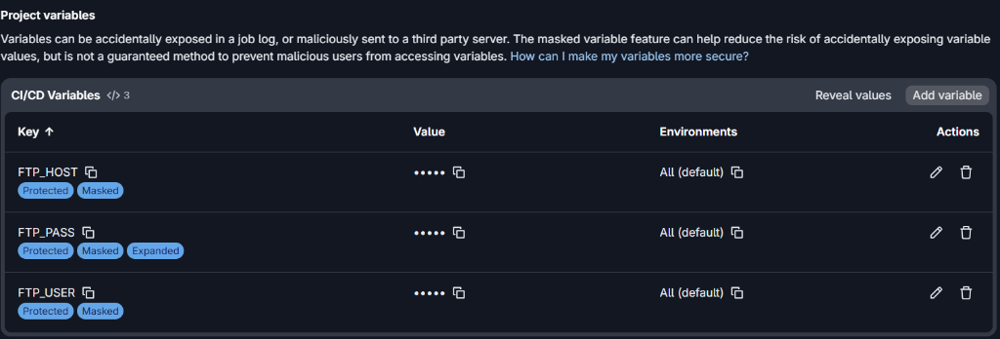
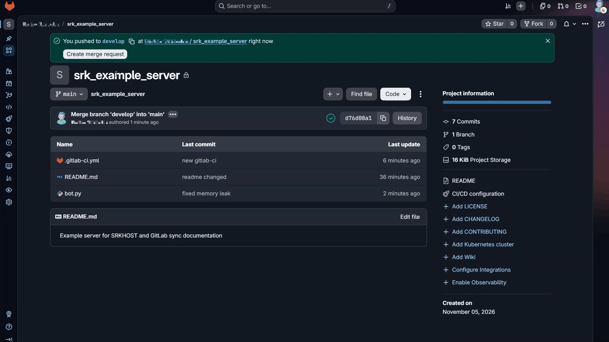

# Fájlok automatikus feltöltése SRKHOST szerverre GitLab CI/CD (SFTP) segítségével

Amikor egy szervert üzemeltetsz (legyen az weboldal, játékszerver vagy egyedi bot), a fájlok manuális másolása SFTP klienseken (pl. FileZilla, WinSCP) keresztül időigényes, monoton, és folyamatosan magában hordozza az emberi tévedések lehetőségét (pl. rossz mappába másolt fájlok, kimaradt frissítések vagy véletlenül felülírt konfigurációk).

Ennek a leírásnak a **célja**, hogy bemutassa: hogyan tudod a GitLabon tárolt kódodat egy automatizált CI/CD pipeline segítségével, biztonságos SFTP kapcsolaton keresztül szinkronizálni az SRKHOST szervereddel minden egyes élesítéskor (git push vagy merge esetén).

:::info **Mi az a CI/CD?** A CI/CD egy automatizálási módszertan, amellyel a Git repository-ba mentett kódváltozásokat a háttérben futó GitLab Runner automatikusan teszteli, buildeli és feltölti a szerverre.:::

---

## Előfeltételek és adatok összegyűjtése

A beállítás előtt gondoskodj a következőkről:

1. **GitLab fiók és projekt:** Egy működő GitLab repository, ahol a projekt kódját kezeled.
2. **Aktív SRKHOST szolgáltatás:** Egy futó szerver (pl. web, bot vagy játékszerver).
3. **SFTP hozzáférési adatok:** Ezeket az SRKHOST szerverkezelő felületén találod:
   - **Szerver címe (Host):** pl. `node01.srkhost.eu` vagy a szerver IP címe.
   - **Port:** Alapértelmezetten a **`2022`**-es portot használjuk SFTP kapcsolathoz.
   - **Felhasználónév (Username):** Az SFTP fiókod azonosítója (pl. `felhasznalonev.a1b2c3d4`).
   - **Jelszó (Password):** A fiókodhoz tartozó jelszó.

:::warning **Hol találod az SFTP adatokat?** Az SRKHOST vezérlőpultján (Pterodactyl panel) válaszd ki a szerveredet, lépj a Beállítások (Settings) menüpontra, és keresd meg az SFTP Details szekciót.:::

---

## 1. Lépés: A GitLab Repository és az ágstratégia (Branches)

A profi és biztonságos fejlesztés alapköve a megfelelő ágkezelés. Soha nem javasolt közvetlenül az éles ágon kísérletezni!

- **`develop` ág:** Ide kerülnek a folyamatban lévő fejlesztések, új funkciók. Ez nem töltődik fel azonnal a szerverre.
- **`main` ág:** Ez a stabil, tesztelt állapotot tükröző ág. A pipeline-t úgy konfiguráljuk, hogy **kizárólag** a `main` ágra történő módosításkor (pl. Merge Request elfogadásakor) induljon el a feltöltés.

### A `main` ág levédése (Protected branch):
1. Navigálj a projektedben a bal oldali menüben ide: **Settings > Repository**.
2. Nyisd le a **Protected branches** szekciót.
3. Győződj meg róla, hogy a `main` ág be van állítva védettként, és a közvetlen push csak a jogosultaknak (Maintainers), vagy senkinek sincs engedélyezve (csak Merge Requesten keresztül).

---

## 2. Lépés: CI/CD Változók (Titkos adatok) beállítása

Az SFTP csatlakozáshoz szükséges adatokat (különösen a jelszavadat) **szigorúan tilos** közvetlenül a kódba vagy a `.gitlab-ci.yml` fájlba beírni, hiszen a repository megtekintői azonnal hozzáférnének a szerveredhez! Ehelyett a GitLab titkosított környezeti változóit használjuk.

1. A GitLab projekt bal oldali menüjében válaszd a **Settings > CI/CD** lehetőséget.
2. Keresd meg a **Variables** szakaszt, és kattints az **Expand**, majd az **Add variable** gombra.
3. Hozd létre az alábbi változókat:

| Változó neve (Key) | Érték (Value) | Környezet (Environments) | Beállítások (Flags) |
| :--- | :--- | :--- | :--- |
| `FTP_HOST` | A szervered címe / IP címe (pl. `node01.srkhost.eu`) | `All (default)` | `Protected`, `Masked` |
| `FTP_USER` | Az SFTP felhasználóneved | `All (default)` | `Protected`, `Masked` |
| `FTP_PASS` | Az SFTP jelszavad | `All (default)` | `Protected`, `Masked`, `Expanded` |



### Mire figyelj a változók rögzítésekor?

:::info **Miért ideális a Protected és Masked beállítás?** A Protected opció biztosítja, hogy a változók csak védett ágakon (pl. main) fussanak le, a Masked pedig elrejti az értékeket a logokban ([MASKED]).:::

#### Fontos tudnivalók a változókról:
- **Protected (Védett):** Mindhárom változó megkapta a `Protected` címkét. Ez maximális biztonságot nyújt: a titkos adatokhoz kizárólag védett ágak (Protected branches, pl. a `main`) férhetnek hozzá. Ha valaki egy nyílt vagy fejlesztői ágon indít pipeline-t, a változók nem lesznek elérhetőek, így kizárt a véletlen élesítés vagy adatlopás.
- **Masked (Maszkolt):** Mindhárom változó el van maszkolva, így a GitLab Runner futási naplóiban (job logs) a jelszó mellett a szerver címe és a felhasználónév sem jelenik meg nyílt szövegként, csupán `[MASKED]` formában.
- **Expanded jelölés az `FTP_PASS`-nál:** Ha a jelszavad tartalmazza a `$` karaktert (pl. `P@ss$word`), a GitLab környezeti változóként próbálhatja feloldani azt az `Expanded` mód miatt, ami levághatja a jelszó egy részét és `Login incorrect` hibát okozhat. Ha a jelszavadban van `$`, a változó szerkesztésénél érdemes kivenni a pipát az **Expand variable** opció elől!
- **Karakterkövetelmények maszkolásnál:** A GitLab elvárja, hogy a maszkolt érték legalább 8 karakter hosszú legyen, egyetlen sorból álljon, és ne tartalmazzon tiltott karakterformátumokat.

:::warning **Figyelem a dollárjelre ($):** Ha az SFTP jelszavadban dollárjel szerepel, kapcsold ki az Expand variable opciót, különben a GitLab változóként kísérli meg behelyettesíteni!:::

---

## 3. Lépés: A Pipeline konfiguráció (`.gitlab-ci.yml`)

A GitLab CI/CD működését a projekt gyökerében elhelyezett `.gitlab-ci.yml` fájl vezérli.

1. Hozz létre a repó gyökerében egy fájlt pontosan ezzel a névvel: `.gitlab-ci.yml`.
2. Illeszd be a következő konfigurációt:

```yaml
stages:
  - deploy

deploy_to_srkhost:
  stage: deploy
  image: alpine:latest
  before_script:
    # Csomaglisták frissítése, lftp és az SFTP-hez szükséges OpenSSH feltelepítése
    - apk update && apk add --no-cache lftp openssh-client
  script:
    # Kapcsolódás és szinkronizáció az LFTP segítségével
    - lftp -c "set sftp:auto-confirm yes; open -u $FTP_USER,$FTP_PASS sftp://$FTP_HOST:2022; mirror -Rnev ./ / --ignore-time --parallel=10 --exclude-glob .git* --exclude .gitlab-ci.yml"
  only:
    # A feltöltés kizárólag akkor fut le, ha a 'main' ágra érkezik módosítás
    - main
```

---

## Az `lftp mirror` parancs részletes magyarázata

A feltöltést a rendkívül gyors és megbízható `lftp` segédprogram végzi. Érdemes megérteni, hogy melyik kapcsoló miért felelős:

| Kapcsoló / Részlet | Jelentése és funkciója |
| :--- | :--- |
| `set sftp:auto-confirm yes` | Automatikusan elfogadja a távoli szerver SSH ujjlenyomatát (host key). Enélkül a kapcsolat megerősítésre várna, és a pipeline időtúllépéssel elszállna. |
| `open -u $FTP_USER,$FTP_PASS ...` | Bejelentkezik az SFTP protokollon keresztül a megadott 2022-es porton a titkosított változók felhasználásával. |
| `mirror` | Tükrözési funkció, amely a forrás- és a célkönyvtár tartalmát összehasonlítva szinkronizál. |
| `-R` (`--reverse`) | Fordított szinkronizálás: a helyi (GitLab Runner) könyvtárat tölti fel a távoli szerverre, nem pedig fordítva. |
| `-n` (`--only-newer`) | Csak az újabb vagy méretben eltérő fájlokat tölti fel, elkerülve a felesleges hálózati forgalmat. |
| `-e` (`--delete`) | **Törli a szerveren lévő fájlokat, ha azok a Git repóban már nem léteznek.** (Lásd a lenti figyelmeztetést!) |
| `-v` (`--verbose`) | Részletes kimenetet generál a CI/CD logba, így pontosan látni fogod, melyik fájlok lettek feltöltve vagy frissítve. |
| `--ignore-time` | A Git nem őrzi meg az eredeti fájl-időbélyegeket (mtime), így a Runner mindig az aktuális időt látná. Ez a kapcsoló biztosítja, hogy a méret és tartalom alapján döntsön a módosulásról. |
| `--parallel=10` | Egyszerre akár 10 párhuzamos szálon tölt fel, ami többszörösére gyorsítja a folyamatot sok kisebb fájl esetén. |
| `--exclude-glob .git*` | Figyelmen kívül hagyja a Git belső mappáit (`.git`, `.gitignore`, `.gitattributes`). |
| `--exclude .gitlab-ci.yml` | Megakadályozza, hogy magát a CI konfigurációs fájlt feleslegesen feltöltse a szerverre. |

:::danger **FIGYELEM: A -e (--delete) kapcsoló veszélyei!** Ha a szervereden futás közben keletkező adatok vannak (pl. database.sqlite, logs/, mentések), és ezek nincsenek a Git repóban, az lftp törölni fogja őket! Dinamikus adatok esetén távolítsd el a -e kapcsolót, vagy adj hozzá --exclude szabályokat!:::

---

## 4. Lépés: A Pipeline futtatása és ellenőrzése

1. Küldd be a módosításokat a repóba (commit & push).
2. Nyiss egy Merge Requestet a `develop` ágról a `main` ágra, majd fogadd el (Merge).
3. A bal oldali menüben navigálj a **Build > Pipelines** (vagy régebbi felületen **CI/CD > Pipelines**) menüpontba.
4. Itt láthatod az éppen futó vagy befejezett feladatot. A `deploy_to_srkhost` jobra kattintva élőben követheted a terminálkimenetet.



:::success **Sikeres lefutás:** Ha a pipeline zöld pipával fejeződik be (Job succeeded), a fájlok sikeresen és hiánytalanul megjelentek az SRKHOST szervereden!:::

---

## Mire figyelj még? (Fontos észrevételek a gyakorlatból)

### 1. Szerver újraindítása / Újratöltés
Az SFTP szinkronizáció kizárólag a fájlokat másolja át a háttértárra.
- Ha például egy **Node.js botot**, **Python alkalmazást** vagy **Minecraft szervert** futtatsz, a fájlok cseréjétől az alkalmazás nem feltétlenül indul újra magától.
- Szükség esetén indítsd újra a szervert a webes vezérlőpulton, vagy használj fájlfigyelő mechanizmust (pl. `nodemon`, `pm2 watch`), amennyiben a futtató környezet ezt támogatja.

### 2. Környezeti konfigurációs fájlok (`.env`) kezelése
Éles környezetben gyakran használsz adatbázis-jelszavakat vagy privát API kulcsokat `.env` fájlban:
- Ezt a fájlt **soha ne pushold fel a Git repóba** (legyen benne a `.gitignore`-ban)!
- Hozd létre a `.env` fájlt közvetlenül az SRKHOST webes fájlkezelőjében.
- Egészítsd ki a pipeline parancsot az `--exclude .env` kapcsolóval, hogy a szinkronizáció ne törölje le vagy ne írja felül a szerveren tárolt éles konfigurációt:
  ```bash
  --exclude .env
  ```

### 3. Függőségek és build folyamatok (`node_modules`, `vendor`)
Soha ne tárolj függőségi könyvtárakat (pl. `node_modules`, `vendor`, `.venv`) a Git repository-ban!
- **Statikus weboldalak / TypeScript / Frontend (React, Vue):** A pipeline-t érdemes kiegészíteni egy build lépéssel, és csak a legenerált `dist/` vagy `build/` mappát feltölteni az SRKHOST-ra.
- **Node.js botok:** Ha a szerver nem telepíti automatikusan a csomagokat induláskor, megfontolandó a build artefaktumok készítése vagy a szükséges modulok célzott kezelése.

### 4. Feltöltés almappába
Ha nem a szerver gyökérkönyvtárába (`/`), hanem egy adott mappába szeretnéd tölteni a kódodat (például egy Minecraft plugin mappájába vagy egy weboldal `public_html` mappájába):
- Módosítsd a cél útvonalat az `lftp mirror` parancsban:
  ```bash
  # Példa: a helyi gyökérből a szerver /plugins/MyPlugin/ mappájába
  mirror -Rnev ./ /plugins/MyPlugin/ ...
  ```

---

## Tippek és trükkök (Pro Tips)

### 1. Tipp: Manuális jóváhagyás az élesítéshez (`when: manual`)
Ha szeretnéd, hogy a kód beolvasztása után a szerverre töltés ne azonnal, hanem csak a jóváhagyásod után (egy gomb megnyomására) fusson le, egészítsd ki a `.gitlab-ci.yml` fájlt a `when: manual` direktívával:

```yaml
deploy_to_srkhost:
  stage: deploy
  image: alpine:latest
  before_script:
    - apk update && apk add --no-cache lftp openssh-client
  script:
    - lftp -c "set sftp:auto-confirm yes; open -u $FTP_USER,$FTP_PASS sftp://$FTP_HOST:2022; mirror -Rnev ./ / --ignore-time --parallel=10 --exclude-glob .git* --exclude .gitlab-ci.yml"
  only:
    - main
  when: manual
```

### 2. Tipp: Próbafuttatás (`--dry-run`) hibakereséshez
Ha félsz attól, hogy a pipeline véletlenül letörölne valamit a szerverről, illeszd be a `--dry-run` kapcsolót az `lftp` parancsba:

```bash
mirror -Rnev --dry-run ./ / ...
```

Ekkor az `lftp` csak szimulálja a műveletet és a logban kiírja, hogy mit csinálna, anélkül, hogy ténylegesen hozzáérne a szerveren lévő fájlokhoz.

### 3. Tipp: Gyorsabb futás Alpine csomaggyorsítótárral
Az `apk add --no-cache` használata megakadályozza a felesleges indexfájlok tárolását a konténerben, így a runner másodpercekkel hamarabb indulhat el.

---

## Gyakori hibák és elhárításuk (Troubleshooting)

| Hibaüzenet a logban | Kiváltó ok | Megoldás |
| :--- | :--- | :--- |
| `Fatal error: Host key verification failed` | Az SSH kliens nem ismeri fel a szervert. | Ellenőrizd, hogy a `set sftp:auto-confirm yes;` parancs pontosan szerepel-e a parancssor elején. |
| `Login incorrect` vagy `Authentication failed` | Hibás felhasználónév vagy jelszó; üres változók. | 1. Ellenőrizd a GitLab változóknál az `FTP_USER` és `FTP_PASS` értékét.<br>2. Ha a változó *Protected*, a futtatott ágnak is *Protected*-nek kell lennie.<br>3. Ha van `$` a jelszóban, kapcsold ki az *Expand variable* beállítást. |
| `Connection timed out` vagy `Connection refused` | A szerver nem elérhető vagy a tűzfal tiltja a kapcsolatot. | 1. Ellenőrizd, hogy a megadott `FTP_HOST` él-e és helyes-e a **2022**-es port.<br>2. Győződj meg róla, hogy az SRKHOST szervered állapota "Running" a vezérlőpulton. |
| `Access denied` | Nincs írási jogosultság a célkönyvtárban. | Ellenőrizd az SFTP felhasználó jogosultságait és a mappa jogosultságait a vezérlőpult fájlkezelőjében. |
| Eltűntek a nem gitben lévő fájlok a szerverről | A `-e` (`--delete`) kapcsoló letörölte az eltérő fájlokat. | Távolítsd el a `-e` kapcsolót az `lftp` parancsból, vagy védd le a mappákat az `--exclude` opcióval. |
